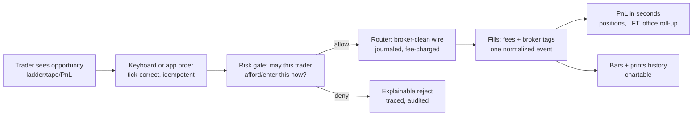

# Trade8 - Vertical Business Requirements & Functionality

> Audience: product owners, business analysts, and anyone evaluating what
> the **trade8 vertical does for the business** as a whole. For architecture
> read the top-level `README.md`; for wire-level detail read the top-level
> `DESIGN.md` and the per-unit documents it references.

## 1. Business Purpose

- Run the **professional trading desk end-to-end** for proprietary desks and
  introducing brokers: enter orders with keyboard-class speed, gate every
  order through pre-trade risk, connect to any broker, and see P&L truth in
  real time.
- Guarantee **complete regulatory traceability**: who acted on which order,
  when, why it was denied (itemized traces), every wire message, every fill
  with preserved broker tags, every money figure reconstructable from
  journals.
- Protect the firm's **capital and entitlements**: exposure limits enforced
  before acceptance, market-data access bought exactly as consumed, secrets
  never stored in the clear.
- Deliver it **as one multi-tenant platform vertical**: organizations and
  environments share one deployment with hard tenant isolation, admin
  surfaces through Dash, and the trader experience through an App Store app.

## 2. Business Scope (What the Vertical Provides)

| Business capability | Service | Where it's specified |
|---|---|---|
| Order entry, cancel, cancel-replace, baskets, one-click flatten | Trade8:Desk | `services/desk/BUSINESS.md` |
| Session lifecycle (preopen→open→close-pending→closed), overnight park/restore | Trade8:Desk | `services/desk/BUSINESS.md` |
| Instrument/routing catalogs (markets, symbols, destinations, fees, reject codes) | Trade8:Desk | `services/desk/BUSINESS.md` |
| Short-sale locate pool (availability, office caps, ETB/HTB, short-exempt) | Trade8:Desk | `services/desk/BUSINESS.md` |
| Pre-trade authorization (buying power, limits, restrictions, trader states) | Trade8:Risk | `services/risk/BUSINESS.md` |
| Loss ladder (day-loss thresholds → close-only/disable) | Trade8:Risk (+Pnl) | `services/risk/BUSINESS.md` |
| Broker connectivity: FIX 4.2/4.4 + OUCH 3.1 sessions, routing, fees, fills | Trade8:Router | `services/router/BUSINESS.md` |
| Market data: vendor adapters, consolidated quotes/ladders, SSE streaming | Trade8:Feed | `services/feed/BUSINESS.md` |
| Price alerts (declarative + tenant-authored composite conditions) | Trade8:Feed (+Func) | `services/feed/BUSINESS.md` |
| OHLCV bars (1s–1D), intraday candles, history windows, EOD finalization | Trade8:Bars | `services/bars/BUSINESS.md` |
| Day P&L: positions, realized/unrealized, fees, LFT, office roll-ups | Trade8:Pnl | `services/pnl/BUSINESS.md` |
| Overnight carry + reconciliation (mismatches surfaced, never silent) | Trade8:Pnl (+Desk) | `services/pnl/BUSINESS.md` |
| Trading keyboard (F-key chain), ladder/tape/charts, P&L board | etrader app | `apps/etrader/BUSINESS.md` |
| Admin workspaces (catalog, risk, sessions, feeds, bars, overnight) | all services via Dash RFW | per-service BUSINESS.md |

### What the vertical does NOT own (business boundary)

| Concern | Owned by |
|---|---|
| Identity, sign-in, credentials, tokens to clients | Sentin8:Auth + Sentin8:BFF |
| Authorization decision engine (Shield RBAC/ABAC/ReBAC) | sentin8-policy (embedded, platform-owned) |
| Scheduling (session times, purge, EOD, carry-outs) | Sentin8:Cron |
| User-authored strategy execution | Sentin8:Func |
| Audit ingest + storage | Sentin8:Sys |
| Venue-side matching, auctions, clearing, regulatory feeds | exchange8 (sibling vertical) |
| Object storage / secret vault | Sentin8:Storage / secrets |

## 3. Business Capabilities

### 3.1 Trading capability chain (the value path)

| Area | Capability | Business rule |
|---|---|---|
| Entry | Keyboard-dense order pad | F-key chain (buy/sell limit & market, cancel-all, flatten) with profile-synced muscle memory |
| Entry | Session-aware acceptance | Orders are accepted only in session state that allows them; rejects are explicit |
| Gating | Fail-closed authorization | No Risk verdict ⇒ no acceptance; denies carry the itemized check trace into the blotter |
| Gating | Instant supervision | Closing-only/disable flips a trader within a second, without touching credentials |
| Routing | Any broker, one model | FIX/OUCH dialect differences are data (templates, fee formulas) - no code per broker |
| Routing | Zero-impact rehearsals | Shadow destinations run the full pipeline without sending |
| Data | Snapshot-then-live streaming | A subscriber sees the current state first, then sequenced live frames with resync on gaps |
| Alerts | Sub-second alerting | Declarative rules fire within a second; complex tenant logic rides Func hooks |
| P&L | One source of money | Fill-derived, exactly-once application; office rolls up from trader numbers by construction |
| Continuity | Exact carry | Next session opens with yesterday's close; divergence raises a visible mismatch |
| Audit | Full reconstruction | Any day replays to identical numbers from journal + opening balances |

### 3.2 Administration capability

| Area | Capability | Business rule |
|---|---|---|
| Catalogs | Symbols, markets, destinations, fees, reject codes, message templates | Admin-editable at runtime; changes are audited; secrets are references |
| Risk | Limits, restrictions, trader states, loss ladder | Effective immediately (cache swap), fully audited, scope-specific (user > office > env) |
| Ops | Session wall, feed health wall, bars coverage, journal browser, overnight queue | Operational actions (reset, ack, finalize) are permission-gated + audited |
| Policies | Shield policy sets, relations, attributes per service | Env admins promote shadow→enforced after observation |

## 4. Business Events (Outbound)

The vertical's event stream is its business nervous system (full table with
producers/triggers in `DESIGN.md` §4):

| Event | Fires when | Business consumers |
|---|---|---|
| `trade8:desk:order:submitted/accepted/rejected/cancelled/replaced/flatten/overnight[:restored]` | The order lifecycle moves | Router (routing), Risk (reservations), app (blotter) |
| `trade8:desk:session:state` | Session opens/closes | Pnl (carry/verification), ops |
| `trade8:desk:borrow:updated` | Locate pool changes | Audit/reporting |
| `trade8:desk:keystroke:logged` | Any order action (incl. proxy) | Compliance |
| `trade8:router:fill:executed/cancelled/rejected` | Broker reports move an order | Pnl (positions), Risk (counters) |
| `trade8:router:session:status` | Broker session transitions | Ops wall |
| `trade8:risk:limit:updated` / `trader:state` | Risk administration | Peer risk instances, audit |
| `trade8:feed:quote:updated/depth/imbalance/trade:printed` | Market data flows | Bars (history), Risk (halt/uptick), Func triggers |
| `trade8:feed:alert:fired` / `feed:status` | Alert triggers / link health | App alerts, ops wall |
| `trade8:bars:bar:closed` / `eod:completed` | Candles close / day finalizes | Charts, reporting |
| `trade8:pnl:position:updated` / `trader:summary` / `office:summary` | Money moves or is marked | Risk (loss ladder), app boards |
| `trade8:pnl:overnight:mismatch` | Carry divergence | Ops reconciliation queue |

**Consumed by the vertical:** desk order acceptance (Router), fills,
session state, prints, quotes, Pnl summaries (by Risk). Every delivery is
outbox-first (durable) and idempotent at the consumer.

## 5. Business Rules & Invariants

1. **No order is accepted without pre-trade authorization**, and an
   unreachable gate rejects rather than waves orders through.
2. **Every financial record has exactly one writer** (orders: Desk; fills:
   Router; positions: Pnl) - no dual-write drift is representable.
3. **Every order action is attributed** (actor + on-behalf-of) and journaled
   - keystroke/audit completeness is regulator-grade.
4. **Broker credentials and vendor secrets are references**, never
   plaintext, in any table or response.
5. **Money is exact** - scaled-integer arithmetic everywhere; no float ever
   touches a price, fee, or P&L number.
6. **Overnight continuity is exact-or-visible**: carry mismatches surface
   as events and an ops queue, never silently roll forward.
7. **Tenant isolation is total** - schema-per-service RLS with declared
   cross-schema reads only; a request without tenant context is rejected.
8. **Event delivery is at-least-once with idempotent consumers** -
   redelivery never double-charges a fee, double-fills a position, or
   double-fires an alert.
9. **The client app holds no tokens** - all traffic is BFF-proxied.
10. **Reconstruction always converges** - replay of journal + opening
    balances reproduces the day's numbers byte-equal (drill-enforced).

## 6. Target-User Roles & Use Cases

| Persona | Use cases |
|---|---|
| Trader | Order entry (F-keys), blotter, depth ladder, tape, charts, P&L board, alerts, flatten |
| Office / branch manager | Office blotter + P&L roll-up, office borrow blocks, office routing overrides |
| Desk supervisor / trading ops | Session open/close, session wall, feed health wall, overnight queue, journal browser |
| Risk manager | Limits wall, trader-state controls (lock out instantly), loss ladder, exposure board |
| Compliance officer | Keystroke/audit trail, deny traces, wire journal, preserved broker fill tags |
| Catalog / back-office admin | Symbols, markets, destinations, fees, templates, reject codes |
| Tenant power user / quant | Composite alert conditions via Func modules; sim/replay feeds for testing |
| Platform operator | Enroll + run the vertical (Debian package, catalog priorities, per-service DSNs) |

## 7. KPIs / Success Criteria

- **Order-acceptance latency**: P50 < 5 ms / P99 < 25 ms in-envelope
  (harness-pinned).
- **Money correctness**: zero drift between trader and office and
  reconstructed numbers; rate conversions exact at scale.
- **Authorization integrity**: zero un-authorized acceptances; every deny
  carries a persisted itemized trace.
- **Event reliability**: no lost journal events (outbox retries until
  delivered); consumer convergence under redelivery.
- **Entitlement integrity**: zero data leakage to unentitled subscribers
  (sub-time rejection, per-topic filtering).
- **Operational readiness**: EOD finalizes on schedule; feed health visible
  without polling; quarterly DR drill passes byte-equal.
- **Test depth**: ~330 Rust tests (unit + Shield + SQL/RLS matrices +
  latency) green; Browser-only UI smoke + trigger specs.

## 8. Dependencies & Reliance on Other Services

| Dependency | Why the business relies on it |
|---|---|
| Sentin8:Auth + Shield | Identity, live role grants, the authorization decision, M2M certificates |
| Sentin8:BFF | All client traffic (tokens server-side); admin proxying |
| Sentin8:Bus | Event transport (outbox-first delivery, consumer groups, DLQ) |
| Sentin8:Cron | Session choreography, journal purge, EOD finalize |
| Sentin8:Func | Executes the flatten/basket/alert strategy modules |
| Sentin8:Sys | Audit ingest; service administration/registration |
| Sentin8:Storage | Cold-tier archive objects (bars history design) |
| PostgreSQL (db `trade8`) | The schemas this vertical owns |
| Brokers / vendors | The counterparties of Router and Feed |
| exchange8 (optional) | Venue-side services when the tenant runs both verticals |

## 9. Acceptance Criteria

1. A trader can sign in and, with keyboard only, enter → see accepted in the
   blotter → watch fills land in P&L - within seconds, on any device.
2. A supervisor can lock a trader (closing-only/disable) in under a second
   with reason + attribution.
3. A denied order shows in the blotter with its full itemized check trace.
4. A broker cutover can be rehearsed in shadow mode with journals proving
   the parity run sent nothing live.
5. A vendor outage is visible on the health wall (degraded/dead) without
   operator polling.
6. Overnight continuity passes with zero silent differences; mismatches
   appear in a queue with expected-vs-actual.
7. Compliance can reconstruct any order's full story (who/what/when/why,
   wire bytes, broker tags, fees).
8. The quarterly DR drill reconstructs the day to byte-equal summaries.
9. Admins manage every catalog/risk surface without engineering visits.
10. Tenant isolation survives adversarial probing (RLS matrices, probe-role
    tests are green).

## 10. Open Business Questions

- Which brokers require native socket transport first (vs. HTTP adapters),
  and what is the per-venue certification checklist?
- Should the loss ladder auto-trigger *flattening* (with whose approval), or
  remain close-only/disable?
- Market-data redistribution policies (per-office quotas) - Shield
  attributes vs. Feed throttling?
- Does the business want intrabar live pushes in the app (vs. pull
  snapshots), and at what throttle?
- What retention period do regulators require for the wire journal (30-day
  default) and day summaries (Storage cold tier)?
- Basket execution: keep the synchronous per-item model, adopt the declared
  async trigger, or both by basket size?

---

**Design attribution:** trade8 and its underlying concepts were designed by Hamid Jahanzad <Hamid@Jahanzad.com>.
