# Trade8 - Vertical Detailed Design Document

> Secure Post-Quantum-Safe Trading Platform That Heals and Scales Itself.

> Audience: maintainers, reviewers, and architects working anywhere in the
> trade8 workspace. This document is the **vertical map**: what exists, how
> the pieces fit, and the invariants that hold across services. Per-unit
> depth: `services/*/DESIGN.md`, `crates/*/README.md`,
> `strategies/*/README.md`, `apps/etrader/{README.md,BUSINESS.md}`;
> business view in the top-level `BUSINESS.md`.

## 1. Scope & Context

Trade8 is the Sentin8 **broker-dealer / professional-trading vertical**. It
owns, as one deployed unit:

- **Order management** - the full order lifecycle (submit → authorize →
  accept → route → fill → terminal), working order state, overnight parking,
  the short-sale locate pool, session control, and the reference catalogs.
- **Pre-trade risk** - the synchronous authorization gate and the
  trader-state/limit/restriction administration behind it.
- **Broker connectivity** - FIX 4.2/4.4 + OUCH 3.1 client sessions,
  destination routing, message templates, fee charging, fills.
- **Market data** - vendor-feed ingestion, normalization, NBBO-style
  consolidation, entitlement-gated SSE streaming, price alerts.
- **Bar aggregation** - OHLCV bars (1s-1D), EOD roll-up, history API.
- **Day P&L** - event-sourced positions, realized/unrealized, LFT,
  summaries, overnight carry.
- **The trader app** - `etrader` (Flutter), a pure BFF client.

**Deliberately out of scope** (owned elsewhere): identity/sign-in and the
authorization *decision* (Sentin8:Auth + Shield); token issuance to clients
(Sentin8:BFF); scheduling (Sentin8:Cron); user-authored strategy execution
(Sentin8:Func); audit ingest (Sentin8:Sys); object storage (Sentin8:Storage);
venue-side matching/clearing (exchange8, a sibling vertical).

### System context (C4 level 1)

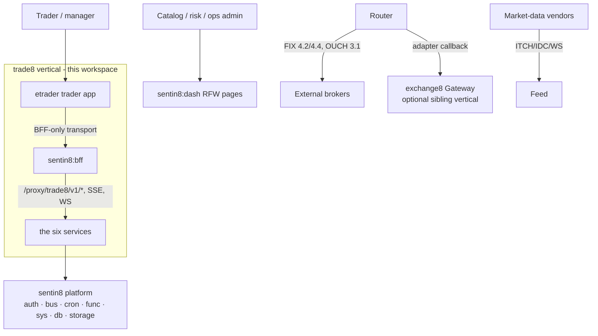

### Container view (C4 level 2)

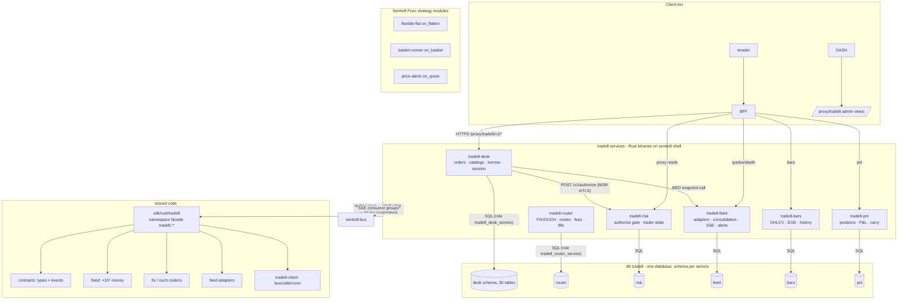

## 2. Runtime Architecture

### The vertical's request families

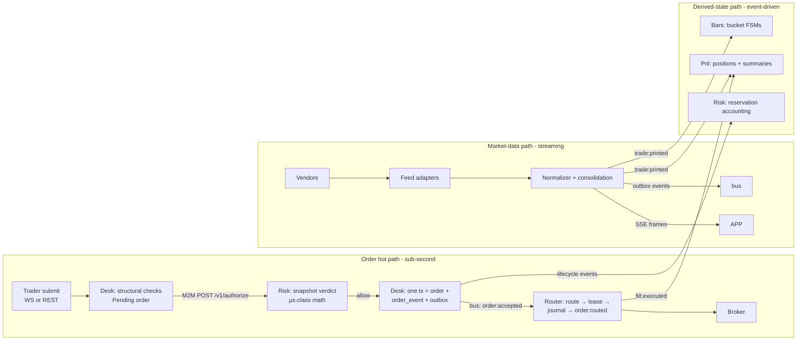

### Boot and runtime wiring (shared shell)

Every service boots on `sentin8::shell::ServiceCore`:

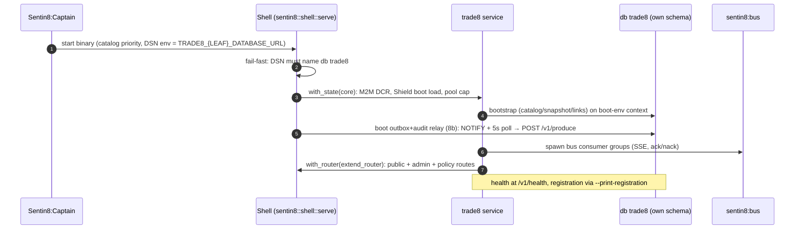

### Request lifecycle - the authoritative order-submit family

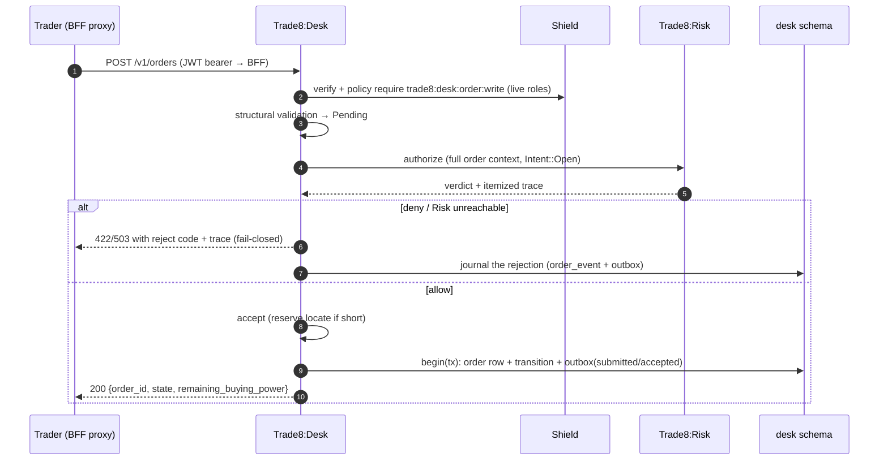

### Request lifecycle - the market-data stream family

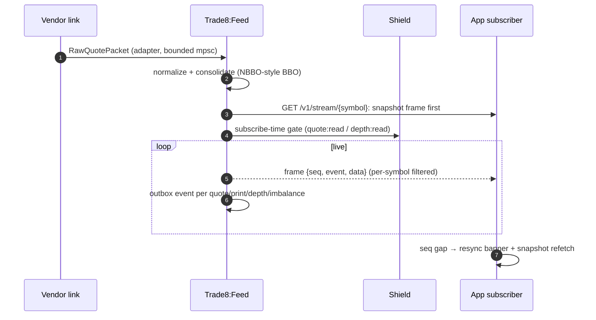

## 3. Data Model

One PostgreSQL database `trade8`, **schema-per-service**; each schema is
private to its service (RLS `ENABLE`+`FORCE`, standard env-block policy on
every table, per-service OAuth role, shell-generated `{schema}.outbox` +
`{schema}.audit_journal`).

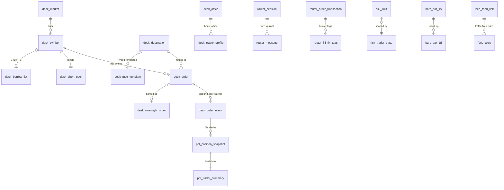

| Schema | Owned tables (selection) | Read grants declared by |
|---|---|---|
| `desk` (30) | `"order"`, `order_event`, `overnight_order`, `keystroke_log`, `short_pool`, `short_pool_office_block`, `borrow_list`, `short_exempt`, catalogs (`market`, `symbol`, `future`, `destination`, `gateway`, `msg_template`, `fee_catalog`, `office`, `trader_profile`, …), `sequence` | - (reads nothing) |
| `router` (4) | `message` (wire journal), `session` (seq/state), `order_transaction` (fills - sole writer), `fill_fix_tags` | `desk.{destination,gateway,market_gateway_destination,office_broker,msg_template}` |
| `risk` (8) | `limit`, `trader_state`, `execution_restriction`, `max_orders_restriction`, `allowed_symbol`, `level`, `action`, `level_action` | `desk.short_exempt` |
| `feed` (4) | `feed_link` (secret-ref credentials), `quote_source`, `alert_rule`, `alert` | - |
| `bars` (7) | `bar_1s…bar_1h` (LIKE base), `bar_1d` (+vwap/official), `eod_report` | - |
| `pnl` (5) | `opening_balance`, `position_snapshot`, `symbol_resume`, `trader_summary`, `office_summary` | `desk.currency` |

Cross-service read access is **declared, not blanket** (register
`cross_schema_grants`, applied by `vertical enroll`). The `sentin8` superuser
is for DDL only; no role carries BYPASSRLS.

### Cross-vertical state machines

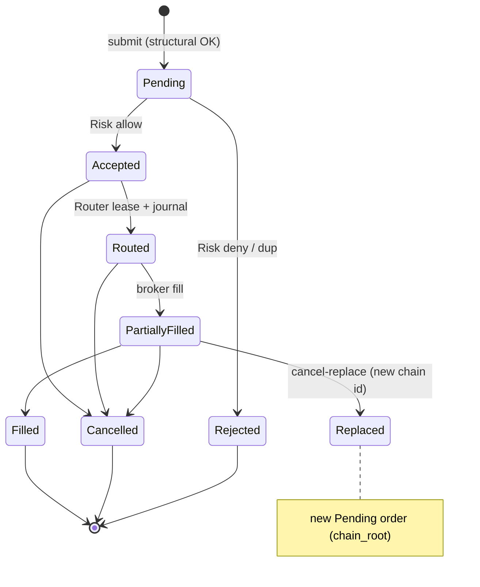

```mermaid
stateDiagram-v2
    direction LR
    [*] --> preopen
    preopen --> open
    open --> close_pending
    close_pending --> closed
    closed --> preopen : next session
    note right of closed : day-TIF remnants cancelled; overnight parked
    note left of preopen : overnight orders restored to Pending
```

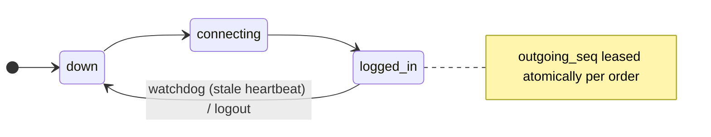

## 4. API Surface

Public API is BFF-proxied (`/proxy/trade8/v1/...`); every route is
Shield-gated (`sentin8-policy`, live-resolved roles; the JWT scope is a
pre-filter, never the decision). Per-service inventories live in
`services/*/DESIGN.md` §4; the vertical surface:

| Service | Public routes (method×path) | Admin (RFW `GET /v1/admin/ui/{page}`) |
|---|---|---|
| Desk | `POST/GET /v1/orders`, `GET/DELETE /v1/orders/{id}`, `POST /v1/orders/{id}/replace`, `POST /v1/orders/batch`, `POST /v1/positions/flatten`, `GET/POST /v1/session`, `GET /v1/symbols`, `GET/POST /v1/borrow`, `GET /ws` | overview, orders, symbols, markets, destinations, offices, borrow, session |
| Risk | `POST /v1/authorize` (M2M-only), `GET/POST /v1/limits`, `GET/POST /v1/trader-state` | limits, traders, restrictions, levels, exposure |
| Router | `GET /v1/sessions`, `POST /v1/sessions/{id}/reset`, `GET /v1/messages`, `POST /v1/journal/purge` (Cron), `POST /v1/internal/executions/{dest}` (M2M) | sessions, journal, fees |
| Feed | `GET /v1/quotes/{symbol}`, `GET /v1/depth/{symbol}`, `GET/POST /v1/alerts`, `GET /v1/feeds`, `GET /v1/stream/{symbol}` (SSE) | feeds, sources, alerts (+ack) |
| Bars | `GET /v1/bars`, `GET /v1/bars/latest`, `GET/POST /v1/eod` | coverage, eod |
| Pnl | `GET /v1/pnl/summary`, `/v1/pnl/positions`, `/v1/pnl/office`, `/v1/pnl/traders`, `POST /v1/pnl/session-close` (Cron) | traders, overnight |

Every service also mounts the shared Shield policy-admin block
(`/v1/admin/policy-sets`, `/v1/admin/relations`, `/v1/admin/attributes`),
`GET /v1/health`, and RFW POST-alias data endpoints.

### Event vocabulary (`trade8::contracts::events`)

Naming law: `vertical:service:resource:operation` - colon-separated, no
dots (test-enforced in the contracts crate). Delivery is outbox-first
(`{leaf}.outbox` row in the domain tx → shell relay → Bus `POST /v1/produce`
→ SSE consumer groups → ack/nack → DLQ).

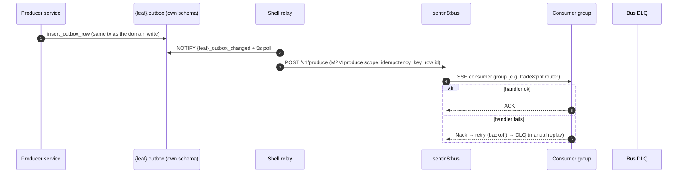

| Family | Emitted (as implemented) |
|---|---|
| desk | `order:submitted/accepted/rejected/cancelled/replaced/routed/overnight/overnight:restored/flatten`, `session:state`, `borrow:updated`, `keystroke:logged` |
| router | `fill:executed/cancelled/rejected`, `session:status` |
| risk | `limit:updated`, `trader:state` |
| feed | `quote:updated`, `depth:updated`, `imbalance:updated`, `trade:printed`, `alert:fired`, `feed:status` |
| bars | `bar:closed`, `eod:completed` |
| pnl | `position:updated`, `trader:summary`, `office:summary`, `overnight:mismatch` |

Declared-but-unemitted constants (prune-or-wire open items, tracked per
service): `desk:catalog:updated`, `desk:borrow:reserved/released/adjusted`,
`risk:restriction:updated`; the `vertical-registry.json` basket trigger
references `trade8:desk:order:batch-requested`, which no producer emits yet.

Consumer wiring (SSE groups over `trade8::client::run_consumer`):

| Consumer | Families | Interested in |
|---|---|---|
| Risk | desk, router, feed, pnl | reservation accounting, position counters, halt/uptick mirror, loss ladder |
| Router | desk | `order:accepted` → route/journal/ack |
| Bars | feed | `trade:printed` → bucket FSMs |
| Pnl | router, desk, feed | fills → positions; session close → carry; prints → marks |

### Declarative triggers (`vertical-registry.json`)

| Trigger | Target |
|---|---|
| `trade8:desk:order:flatten` → | Func `trade8-flexible-flat` `on_flatten` (3 retries exp.) |
| `trade8:desk:order:batch-requested` → | Func `trade8-basket-runner` `on_basket` (3 retries exp.) |
| `trade8:feed:quote:updated` → | Func `trade8-price-alerts` `on_quote` (5 retries linear) |

## 5. Cross-Cutting Concerns

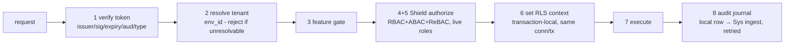

- **Authorization** - every route evaluates the embedded Shield engine at
  step 5; policy sets are seeded per service (`scope-mirror` over the live
  effective scope set), hot-reloaded; step 5 is the only gate.
- **Tenant isolation** - `set_tenant_context` + `begin()` on the same
  connection; explicit `WHERE env_id = $N` defense-in-depth; RLS is the
  backstop (probe-role matrix tests prove 0-rows without context).
- **Idempotency** - client order ids (Desk), transaction ids (fills),
  atomic sequence leases (Router), merge upserts (Bars), fill dedupe
  (Pnl), bounded-queue backpressure everywhere fan-out exists.
- **Secrets** - provider credentials live as *references*
  (`credentials_ref`) in `desk.destination` / `feed.feed_link`; no
  plaintext anywhere in the vertical's tables.
- **TLS** - post-quantum platform TLS (`sentin8-tls`: X25519MLKEM768,
  ML-DSA-65); service-to-service calls present the workload certificate
  (auth DESIGN §4.3f - no M2M token); the BFF holds
  user tokens server-side (the app never sees one).
- **Audit** - desk `keystroke_log` + per-schema `audit_journal` rows in the
  domain tx; Sys ingest is retried until pushed.
- **Drain** - service restarts go through Sentin8:Captain
  (`make upgrade-instance`); sessions/engines are DB-backed so the swap
  is seamless.

## 6. Failure Modes & Recovery

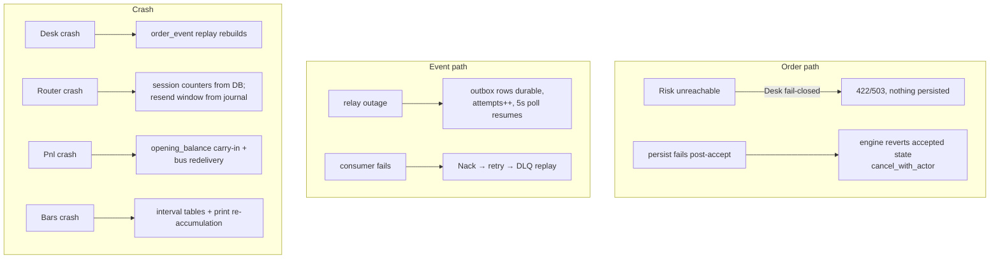

- The full day-reconstruction procedure is scripted: `docs/dr-replay-runbook.md`
  (`make drill-replay`) - quarterly drill, byte-equal convergence required.
- Every durable write is either (a) idempotent-under-redelivery or
  (b) transactional with the journal; no dual-written financial state
  exists anywhere in the vertical.

## 7. Concurrency & Performance Model

  (wasm32 strategies exempt); master-design cross-cutting decision.
- **Hot-path budgets** (master §11; harness-pinned per service): order
  acceptance P50 < 5 ms / P99 < 25 ms in-envelope; quote-to-SSE < 1 ms;
  bar roll-up and fill-to-summary in their CI-harness budgets.
- **State shapes** - Desk: mutex-guarded working map + snapshot catalog;
  Risk: single `arc-swap` snapshot generation per authorize + mutex journal
  maps; Feed: `RwLock` maps + broadcast SSE channel; Bars: `RwLock` bucket
  FSMs; Pnl: `RwLock` books/summaries + dedupe set; Router: consumer loop +
  atomic SQL leases. All locks guard pure in-memory operations only (no
  I/O under lock).
- **Pools** - `sentin8_config::pg_pool::connect` caps every pool
  (`SENTIN8_PG_POOL_MAX`); store calls are tx-scoped (≤1 connection per
  request).
- **Backpressure** - bounded mpsc (adapters), bounded broadcast + per-topic
  seq (SSE), bounded queues (fan-out), SQL-side lease/downgrade instead of
  in-process scheduling.

## 8. Invariants, Insecure-Defaults Rejected, Unsafe Rationale

1. **One writer per financial record** - Desk writes orders/ journal;
   Router is the sole writer of fills (relocated from Desk deliberately);
   Pnl writes only derived positions/summaries.
2. **No un-authorized acceptance** - Desk accepts only on a Risk allow
   verdict, fail-closed when Risk is unreachable.
3. **No cross-service table access without declaration** - the three read
   grants in §3 are the complete list; everything else is API/events.
4. **Money never floats** - `trade8::fixed` raw integers + explicit scale
   end-to-end (×10⁴ money, instrument tick scales, ×10⁸ crypto).
5. **Event names are the contract** - colon-separated four-segment names,
   verified by contract tests; consumers dedupe on idempotency keys.
6. **Secrets by reference**; no plaintext credentials, tokens, or keys in
   any trade8 table.
7. **No `unsafe` blocks** in the workspace; codecs verify checksums/frame
   lengths and return typed errors - ingest paths never panic on bad input.
8. **Journal-first** - every derived surface (positions, fills, bars) is
   reconstructable from the event log + opening balances.

## 9. Testing Strategy

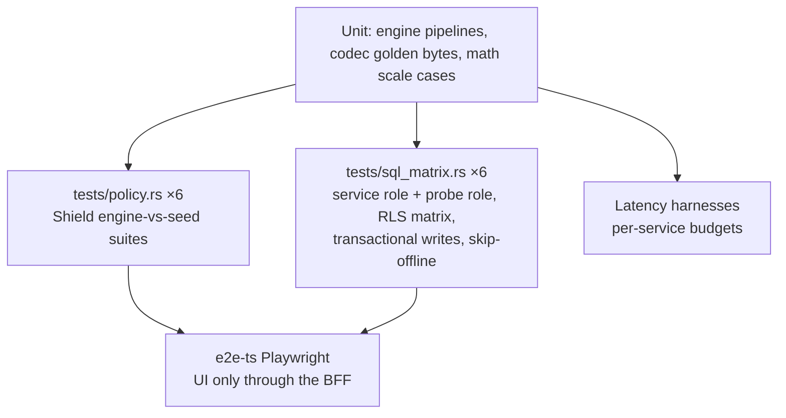

| Layer | Owns | Count (approx) |
|---|---|---|
| Unit (in-crate) | state machines, codecs, math, event law | 180+ |
| `tests/policy.rs` | Shield wiring per service (deny/shadow/M2M parity/relations) | 66 |
| `tests/sql_matrix.rs` | RLS matrix, transactional persistence, per-schema behaviors | ~45 (skip-offline) |
| Latency harnesses | budget guards per service | 6 |
| `e2e-ts` | app shell + declarative triggers (Function exec) via browser+BFF only | smoke + 2 trigger specs |

Deliberately **not** tested in this workspace: platform transport (sentin8),
broker live-wire behavior (sim/parity adapters cover), venue matching
(exchange8).

## 9.1 Fleet-run scope (group operations,)

The group Makefile's `make start` boots ONLY the platform base
(`sentin8:acme, sentin8:auth, sentin8:proxy, sentin8:bus, sentin8:sys,
sentin8:bff, sentin8:web`) plus this group's services - the
`SENTIN8_SERVICES` boot pin when captain is down, the idempotent
`captain start <types>` API form when it is up. `make stop` stops only
this group's instance rows (the captain and platform stay up). The
full rule (service / group / tree-root scopes and the platform-scoped
dev reset): `design/sentin8-repository-split-design.md` §4.5.2.

## 10. Open Questions (vertical-level)

- **Dead event constants** - prune or emit `catalog:updated`,
  `borrow:reserved/*`, `restriction:updated`; and confirm the async basket
  trigger (`order:batch-requested`) vs the synchronous batch path.
- **Router socket transport** - dial-out for native FIX/OUCH endpoints
  (state machines, codecs, resend windows are ready; the transport wiring
  remains).
- **Session-open anchor for Bars** - per-day Cron reset vs calendar read.
- **Cold-tier replay loop** (Bars archive → rehydrate; Pnl journal-first
  replay beyond bus retention).
- **Deny-by-default trader states** - env opt-in instead of
  active-by-default.
- **Registration/route parity** - a few `registration.rs` data-endpoint
  declarations have no route (or vice versa): implement or prune.
- **Catalog replication across envs** - owner-env authoring vs per-env
  copies reconciled by events.

---

**Architecture & Design:** trade8 and its underlying concepts were designed by [Hamid Jahanzad](https://www.linkedin.com/in/hamidjahanzad/).
